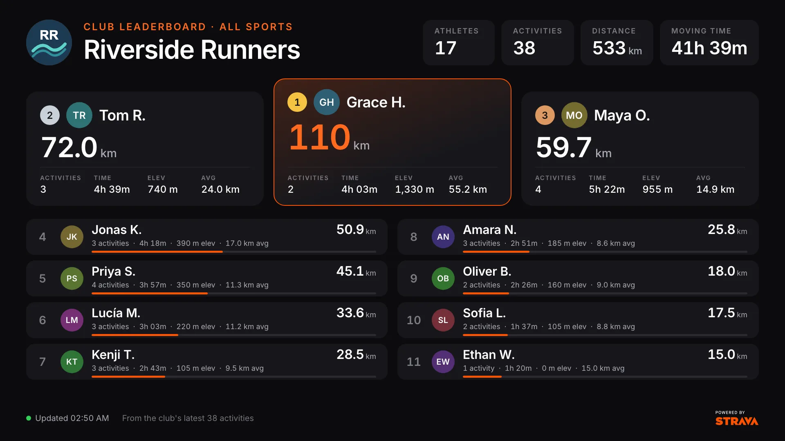
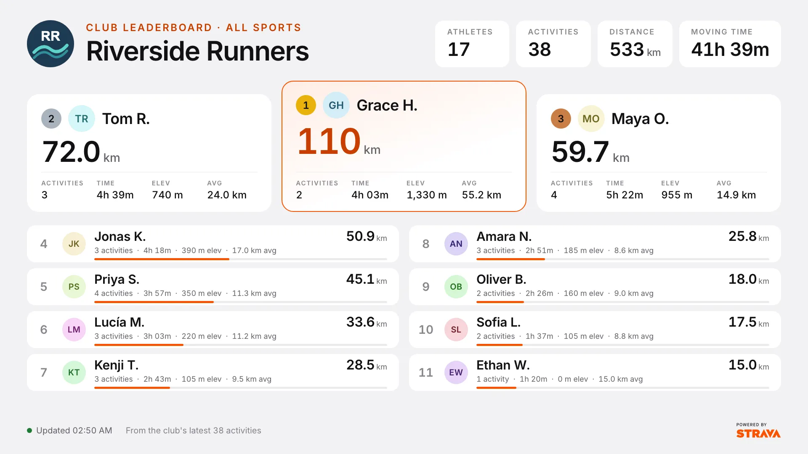

[](https://github.com/Screenly/strava-club-leaderboard-app/releases/latest)

# Strava Club Leaderboard Edge App

A beautiful, real-time leaderboard for Strava clubs that displays member rankings based on activity data. Perfect for motivating team members and displaying club achievements on Screenly Players.





## Features

- **Podium and ranked list**: the top three on a podium, everyone else ranked below with a bar against the leader. As many rows as fit the screen, landscape or portrait.
- **Per-sport ranking**: rank on running, cycling, swimming or walking and hiking, as Strava's own club leaderboards do, or on every sport together.
- **The right average for the sport**: pace per km or mile for running and walking, pace per 100 m or 100 yd for swimming, speed for cycling, average distance for all sports.
- **Dark and light themes**, metric or imperial units.
- **Opens instantly**: the last leaderboard is kept on the screen and shown straight away. Strava is only asked again once it is older than 15 minutes, so a playlist that shows the app every few minutes doesn't spend API requests on every turn.
- **Rate-limit aware**: when Strava's rate limit is reached the app keeps the last leaderboard on screen and waits until the limit resets (the next quarter hour, or midnight UTC for the daily limit) instead of retrying.
- **Automatic token refresh**: the latest access and refresh tokens Strava issues are kept on the screen, so a reload doesn't start again from an expired token or lose a rotated refresh token.

### What the numbers cover

Strava's club activity feed doesn't include activity dates or athlete IDs. The leaderboard therefore covers the club's **latest activities** (up to 1,000), not a calendar week. Athletes are identified by first name and last initial, the only name Strava gives. Ranking is by distance; ties go to less moving time, then more elevation, then name.

## Prerequisites

- Screenly CLI installed ([installation guide](https://github.com/Screenly/cli))
- Strava API access (free Strava account required)
- Access to a Strava club (as member or admin)

## Strava API Setup

### 1. Create a Strava App

1. Go to [Strava API Settings](https://www.strava.com/settings/api)
2. Click "Create App" if you don't have one
3. Fill in the application details:
   - **Application Name**: Your app name (e.g., "Club Leaderboard")
   - **Category**: Choose "Visualizer"
   - **Club**: Select your club
   - **Website**: Your Site or Screenly Playground URL
   - **Authorization Callback Domain**: `localhost` (for testing)

### 2. Get Your API Credentials

After creating the app, you'll see:

- **Client ID**: A numeric ID (e.g., 168413)
- **Client Secret**: A secret string (keep this private)
- **Access Token**: Your personal access token
- **Refresh Token**: For long-term access (**required for automatic token renewal**)
- **Expires At**: Unix timestamp when the access token expires

### 4. Find Your Club ID

1. Go to your Strava club page
2. The URL will look like: `https://www.strava.com/clubs/YOUR_CLUB_ID`
3. Copy the club ID from the URL

## Installation

### 1. Clone the Repository

```bash
git clone https://github.com/Screenly/Playground.git
cd Playground/edge-apps/strava-club-leaderboard
```

### 2. Login to Screenly

```bash
screenly login
```

### 3. Create the Edge App

```bash
screenly edge-app create \
    --name "Strava Club Leaderboard" \
    --in-place
```

### 4. Deploy the App

```bash
screenly edge-app deploy
```

### 5. Create an Instance

```bash
screenly edge-app instance create
```

## Configuration

### Required Settings

Set your Strava API credentials:

```bash
# Set your Strava Client ID
screenly edge-app setting set client_id=YOUR_CLIENT_ID

# Set your Strava Client Secret (secure)
screenly edge-app secret set client_secret=YOUR_CLIENT_SECRET

# Set your Strava Access Token (secure)
screenly edge-app secret set access_token=YOUR_ACCESS_TOKEN

# Set your Strava Refresh Token (secure) - for automatic token renewal
screenly edge-app secret set refresh_token=YOUR_REFRESH_TOKEN

# Set your Strava Client Secret (secure) - required for token refresh
screenly edge-app secret set client_secret=YOUR_CLIENT_SECRET

# Set your Club ID
screenly edge-app setting set club_id=YOUR_CLUB_ID
```

### Optional Settings

| Setting         | Values                               | Default  |
| --------------- | ------------------------------------ | -------- |
| `activity_type` | `all`, `run`, `ride`, `swim`, `walk` | `all`    |
| `theme`         | `dark`, `light`                      | `dark`   |
| `unit_type`     | `metric`, `imperial`                 | `metric` |
| `sentry_dsn`    | Sentry DSN for error reporting       | —        |

## Development

```bash
bun install
bun run dev          # local dev server (uses mock-data.yml)
bun run test         # unit tests
bun run test:e2e     # browser tests against a mocked Strava API
bun run screenshots  # regenerate screenshots/
bun run build        # production build in dist/
```

## Usage

### Viewing the Leaderboard

1. Open your Screenly dashboard
2. Navigate to Assets
3. Find your "Strava Club Leaderboard" app
4. Add it to a playlist
5. Assign the playlist to your device

### Leaderboard Features

- **Rankings**: Athletes ranked by total distance in the selected time period
- **Statistics**: Each athlete shows:
  - Total distance covered
  - Total elevation gained
  - Average distance per athlete
  - Total time spent
  - **Auto-refresh**: Updates every 5 minutes
  - **Time Period**: Shows "This Week" or "This Month" based on settings

### Supported Screen Resolutions

The app is optimized for all Screenly-supported resolutions:

- 4K displays (3840x2160)
- Full HD (1920x1080)
- HD (1280x720)
- Standard (1024x768)
- Portrait orientations
- Raspberry Pi screens (800x480 and below)

## Automatic Token Management

The app includes robust token management to ensure uninterrupted operation:

- **Pure JavaScript management**: Token expiry is managed entirely in memory with no external dependencies
- **Proactive refresh**: Tokens are refreshed 5 minutes before expiry (when expiry is known)
- **Reactive handling**: If expiry time is unknown, handles token refresh automatically on 401 errors
- **Automatic retry**: If a request fails due to token expiry, the app automatically refreshes and retries
- **Zero configuration**: No need to set or manage expiry timestamps manually
- **Error recovery**: Clear error messages guide users to resolve authentication issues
- **No manual intervention**: Once configured, the app maintains itself without user interaction

This is particularly important for digital signage where the display may run unattended for weeks or months.

## Support

For issues or questions:

- Check the [Screenly documentation](https://developer.screenly.io/edge-apps)
- Visit the [Strava API documentation](https://developers.strava.com/docs)
- Contact Screenly support
- Open an issue in the repository

---

**Note**: This app requires a Strava account and API access. Ensure you comply with Strava's API terms of service and rate limits.

## Releasing

Pushes to `main` start a stage deploy, which waits for approval. To release to production, tag a commit on `main` and push the tag (the workflow refuses tags not on `main`); the production deploy also waits for approval:

```bash
git checkout main && git pull
git tag v26.10.0
git push origin v26.10.0
```

Then publish a GitHub Release whose notes list the pull requests merged since the previous release. Add `--draft` to review the notes before publishing:

```bash
gh release create v26.10.0 --verify-tag --generate-notes --title v26.10.0
```
